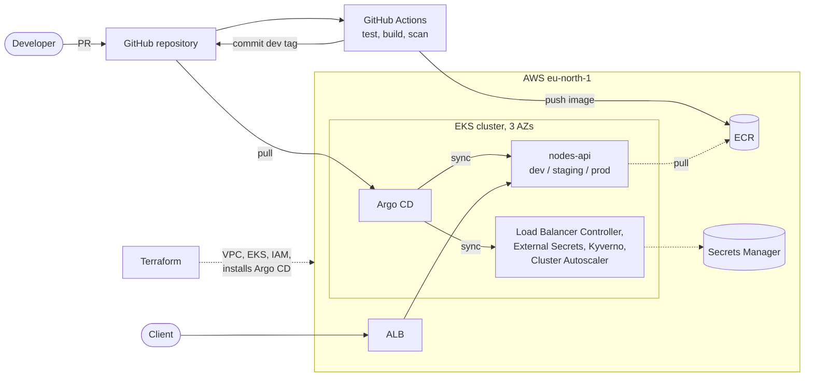

# Kubernetes GitOps Platform

A reference implementation of a cloud-native delivery model on AWS: a small Python service
(`nodes-api`) deployed to Amazon EKS through Argo CD, with CI, least-privilege RBAC, secrets
from AWS Secrets Manager, policy-as-code and a documented monitoring and production design.

## Architecture



One EKS cluster in `eu-north-1` across three AZs, one namespace per environment. Terraform
builds the AWS infrastructure and installs Argo CD; Argo CD deploys everything else from this
repository. CI builds, scans and pushes images, and never deploys to the cluster.

Detailed diagrams (runtime and network, delivery, GitOps structure):
[docs/architecture.md](docs/architecture.md).

## The service

| Endpoint | Purpose |
|---|---|
| `GET /health` | Liveness: the process is up |
| `GET /ready` | Readiness: the Kubernetes client is configured |
| `GET /nodes` | The cluster's nodes; `current: true` marks the node this pod runs on. Requires the `X-API-Key` header |
| `GET /metrics` | Prometheus metrics: requests by route and status, latency, Kubernetes API errors |

The pod's ServiceAccount may only `list` nodes (ClusterRole + ClusterRoleBinding), because
nodes are cluster-scoped.

## Where each requirement is

| Requirement | Where |
|---|---|
| Application, Dockerfile | [app/](app/), [ADR 0004](docs/decisions/0004-application-and-container-image.md) |
| Kubernetes resources (Deployment, Service, Ingress, ConfigMap, Secret, ServiceAccount, RBAC, probes, resources, securityContext, HPA, PDB, NetworkPolicy) | Helm chart [charts/nodes-api/](charts/nodes-api/) |
| Namespaces, environment configuration | [argocd/platform/namespaces/](argocd/platform/namespaces/), [environments/](environments/) |
| GitOps structure (Argo CD) | [argocd/](argocd/), [ADR 0002](docs/decisions/0002-argo-cd-for-gitops.md) |
| CI pipeline, tagging, promotion, update strategy, rollback, reconciliation and drift | [.github/workflows/](.github/workflows/), [docs/gitops-and-delivery.md](docs/gitops-and-delivery.md), [ADR 0005](docs/decisions/0005-promotion-and-ci-write-back.md) |
| Infrastructure as code | [infra/terraform/](infra/terraform/), [ADR 0003](docs/decisions/0003-eks-platform-baseline.md) |
| Secrets management (bonus) | [ADR 0007](docs/decisions/0007-secrets-with-external-secrets.md), [argocd/platform/secret-stores/](argocd/platform/secret-stores/) |
| Policy-as-code (bonus) | [policies/](policies/), [ADR 0008](docs/decisions/0008-policy-as-code-with-kyverno.md) |
| Monitoring, logging, alerts | [monitoring/elastic/](monitoring/elastic/), [ADR 0009](docs/decisions/0009-monitoring-with-elastic.md) |
| Production design and recommendations | [docs/production-design.md](docs/production-design.md) |

## Deployment

Prerequisites: an AWS account, Terraform ≥ 1.10, AWS CLI ≥ 2.32, kubectl, and an AWS profile
with admin rights (`aws login --profile k8s-gitops`).

1. **Infrastructure.** Apply the two Terraform stacks, `bootstrap` (state bucket) and
   `platform` (VPC, EKS, ECR, IAM, Secrets Manager, Argo CD). Step by step:
   [infra/terraform/README.md](infra/terraform/README.md).
2. **Cluster access.** Write the kubeconfig to its own file, so no other cluster can be
   reached by mistake:

   ```bash
   aws eks update-kubeconfig --region eu-north-1 --name k8s-gitops \
     --kubeconfig ~/.kube/k8s-gitops --alias k8s-gitops
   export KUBECONFIG=~/.kube/k8s-gitops    # PowerShell: $env:KUBECONFIG="$HOME\.kube\k8s-gitops"
   ```

3. **Everything else comes from Git.** The root Application syncs the AppProjects, the
   platform add-ons and the three environments, in that order. Wait until all
   Applications are `Synced` and `Healthy` (about 10 minutes on a new cluster):

   ```bash
   kubectl -n argocd get applications
   ```

4. **CI** (only to build new images): the GitHub OIDC role is created by Terraform. The
   `promote-dev` job needs the GitHub App described in ADR 0005, with its client ID in the
   `CI_APP_CLIENT_ID` variable and its private key in the `CI_APP_PRIVATE_KEY` secret.

**Destroy:** delete the Ingresses first, then `terraform destroy`; see
[infra/terraform/README.md](infra/terraform/README.md#destroy).

## Using it

One ALB serves all environments, each on its own port, because there is no domain:

| Environment | URL |
|---|---|
| prod | `http://<alb-dns>/` |
| dev | `http://<alb-dns>:8080/` |
| staging | `http://<alb-dns>:8081/` |

```bash
ALB=$(kubectl -n prod get ingress nodes-api -o jsonpath='{.status.loadBalancer.ingress[0].hostname}')
curl "http://$ALB/health"

# /nodes needs the environment's API key, kept in Secrets Manager
KEY=$(aws secretsmanager get-secret-value --secret-id k8s-gitops/prod/nodes-api \
  --query SecretString --output text | jq -r .api_key)
curl -H "X-API-Key: $KEY" "http://$ALB/nodes"
```

```powershell
$alb = kubectl -n prod get ingress nodes-api -o jsonpath='{.status.loadBalancer.ingress[0].hostname}'
$key = (aws secretsmanager get-secret-value --secret-id k8s-gitops/prod/nodes-api `
  --query SecretString --output text | ConvertFrom-Json).api_key
Invoke-RestMethod -Uri "http://$alb/nodes" -Headers @{ "X-API-Key" = $key }
```

For dev or staging, use the port and the secret of that environment
(`k8s-gitops/dev/nodes-api`, `k8s-gitops/staging/nodes-api`).

**Argo CD UI:** not exposed to the internet. Open it with a port-forward and the local
`admin` user; the password is read from the cluster, see
[infra/terraform/README.md](infra/terraform/README.md#argo-cd).

## Repository layout

```
├── app/                    # nodes-api source (FastAPI), tests, Dockerfile
├── charts/nodes-api/       # Helm chart for the service
├── environments/           # Helm values: common (cluster-wide) + dev, staging, prod
├── argocd/
│   ├── bootstrap/          # AppProjects and the platform and apps Applications
│   ├── platform/           # namespaces, add-ons, SecretStores, policies
│   └── apps/               # ApplicationSet: nodes-api × 3 environments
├── infra/terraform/
│   ├── bootstrap/          # Terraform state bucket
│   └── platform/           # VPC, EKS, ECR, IAM, Secrets Manager, Argo CD
├── policies/               # Kyverno ValidatingPolicies and their tests
├── monitoring/elastic/     # monitoring design and alert rules as code
├── docs/                   # architecture, delivery, production design
│   └── decisions/          # Architecture Decision Records (ADRs)
├── .github/workflows/      # CI: app, chart, terraform
└── .kube-linter.yaml       # static checks for rendered manifests
```

## Assumptions

- **A review environment, not production.** It runs until the review and is then destroyed,
  within a total budget of $200.
- **The AWS account is on the Free plan.** Only Free Tier eligible instance types launch, and
  the On-Demand vCPU quota is 8.
- **No domain.** The service is reached by the ALB DNS name over HTTP.
- **The service is stateless**, so there is no data to back up; the cluster can be rebuilt
  from Git and Terraform.
- **A single operator** applies Terraform from a workstation; nothing else needs AWS admin
  rights.
- **The assignment accepts Flux or Argo CD.** Argo CD is used; Flux's reconciliation model is
  explained in [docs/gitops-and-delivery.md](docs/gitops-and-delivery.md#reconciliation-and-drift).

## Design decisions

Each significant decision is recorded as an ADR in [docs/decisions](docs/decisions/):

| ADR | Decision |
|---|---|
| [0001](docs/decisions/0001-single-repository-layout.md) | Single repository, chart separated from environment values |
| [0002](docs/decisions/0002-argo-cd-for-gitops.md) | Argo CD as the GitOps controller |
| [0003](docs/decisions/0003-eks-platform-baseline.md) | EKS platform baseline: network, access, nodes, registry |
| [0004](docs/decisions/0004-application-and-container-image.md) | Application stack and container image |
| [0005](docs/decisions/0005-promotion-and-ci-write-back.md) | Promotion between environments and CI write-back to Git |
| [0006](docs/decisions/0006-ingress-shared-alb.md) | Ingress through one shared ALB |
| [0007](docs/decisions/0007-secrets-with-external-secrets.md) | Secrets from AWS Secrets Manager through External Secrets Operator |
| [0008](docs/decisions/0008-policy-as-code-with-kyverno.md) | Policy-as-code with Kyverno |
| [0009](docs/decisions/0009-monitoring-with-elastic.md) | Monitoring with Elastic, documented and not deployed |

## Trade-offs

| Choice | Gained | Given up |
|---|---|---|
| One cluster, namespace per environment | One control plane, one NAT, one ALB: affordable | A cluster-wide failure or mistake reaches prod |
| One shared ALB, a port per environment | One load balancer to pay for | No TLS, no host names; an Ingress error in dev can block changes to the group |
| Argo CD over Flux | UI, ApplicationSet, sync waves, team experience | More components (UI, Redis, repo server) |
| CI commits the dev tag through a GitHub App | Continuous delivery to dev with every change in Git | One actor may bypass the `main` ruleset (ADR 0005) |
| Secrets Manager + ESO over SOPS | No secret in Git at all, rotation without a commit | An extra controller and an AWS dependency |
| Kyverno over OPA Gatekeeper | Policies in YAML/CEL, CLI tests in CI | A fail-closed webhook that must stay available |
| Monitoring documented, not deployed | Fits the node and budget limits | The alert rules are validated, never executed |
| Cluster Autoscaler over Karpenter | Simple, works with the managed node group | One instance type; no Spot or consolidation |

## Known limitations

- **HTTP only:** no domain, no TLS certificate.
- **Single NAT gateway:** losing its AZ stops outbound traffic (image pulls, AWS APIs).
- **Public API endpoint**, limited to an allow-listed IP; the list must be updated when the
  operator's IP changes.
- **Capacity:** the 8 vCPU quota caps the cluster at four nodes. Node updates use the
  `MINIMAL` strategy, which removes a node before adding its replacement.
- **Cluster Autoscaler v1.36.1** runs one minor version behind the cluster (1.37), because no
  1.37 release exists yet.
- **Monitoring is not deployed.** No metrics or logs are collected in the running cluster.
- **Argo CD** uses its local `admin` user, without SSO, and is managed by Terraform rather
  than by itself.
- **Manual steps:** Terraform is applied from a workstation, and promotion PRs are opened by
  hand.
- **Secret rotation** is a version bump in Terraform, not automatic.
- **No image signing:** the registry policy checks where an image comes from, not who built it.

## Production recommendations

Summary; the full design is in [docs/production-design.md](docs/production-design.md).

1. A cluster per environment and an AWS account for prod, with SSO for people.
2. A domain with Route 53, ACM certificates, WAF and ExternalDNS.
3. Private API endpoint, NAT per AZ, VPC endpoints and egress filtering.
4. Karpenter with Graviton and Spot for non-prod.
5. Signed images, verified by a Kyverno policy.
6. Customer managed KMS keys and automatic rotation for secrets.
7. Terraform `plan` on PRs and `apply` after approval from CI, through its own OIDC role.
8. Monitoring deployed with SLO-based alerts and on-call routing.
9. Velero for anything Git cannot rebuild, and a warm standby region for DR.
