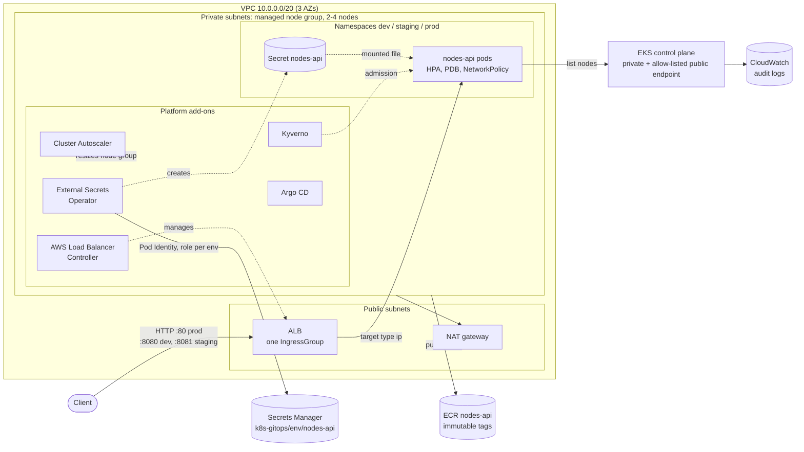
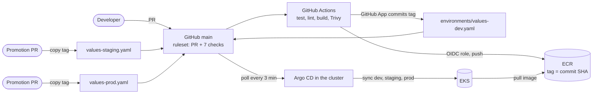
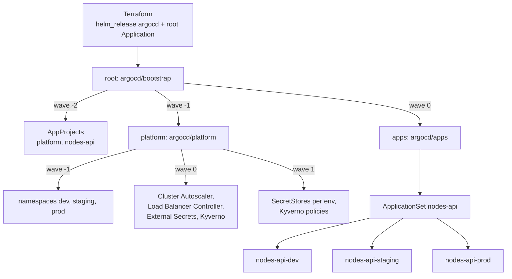

# Architecture

## Runtime

One EKS cluster in `eu-north-1`, three availability zones. Each environment is a namespace.

| Layer | What runs there |
|---|---|
| Public subnets | Only the ALB and the NAT gateway. Nodes have no public IPs |
| Private subnets | All nodes and pods. Pod IPs come from the VPC (VPC CNI, prefix delegation) |
| `dev`, `staging`, `prod` | nodes-api: 1-2, 2-3 and 3-6 replicas. PSA `restricted`, default-deny NetworkPolicy |
| Platform namespaces | Argo CD (installed by Terraform), everything else installed by Argo CD |
| AWS services | ECR for images, Secrets Manager for the API keys, CloudWatch for control plane logs, KMS for Secret encryption in etcd |

## Delivery

CI builds and pushes images; it never talks to the cluster. Argo CD pulls every change from Git.

## GitOps structure

Terraform installs Argo CD and one root Application. Everything else comes from `argocd/`.

